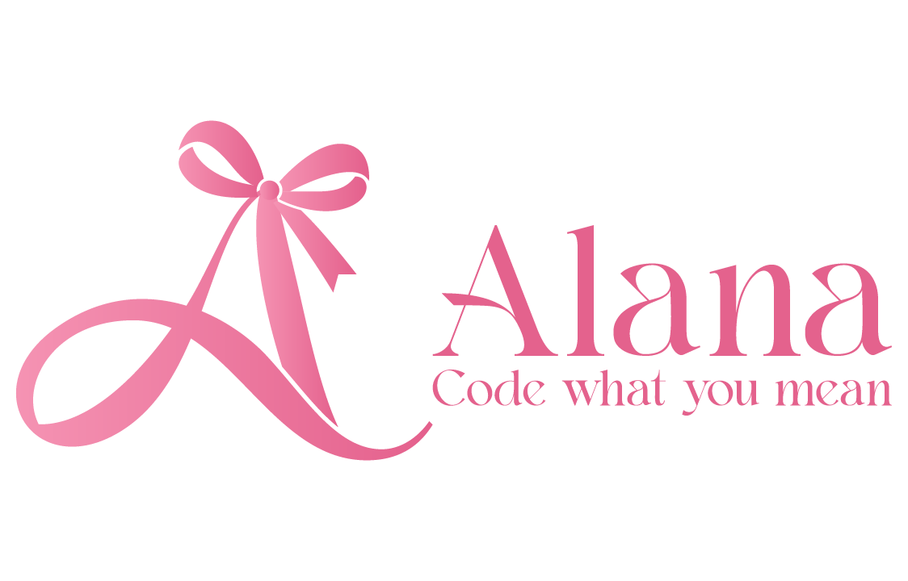

# AlanaStdLib v0.2


> Check out the official [Alana website](https://csalana.com)

> Check out the official [Alana runtime](https://github.com/Daegatoya/Alana)
<hr>

**Welcome to AlanaStdLib**, the official standard library made for the [Alana programming language](https://csalana.com).

Currently, the standard library is only available through the official Alana language's download.

## What is currently included in the stdlib
- [x] HTTP POST/GET
- [x] JSON Serialize
- [x] Error Handler 

**A code using Alana's standard library could look like this:**

```txt
including "stdlib/http.alana";
including "stdlib/json.alana";
including "stdlib/error.alana";

define Http http is newobj Http();
define Json json is newobj Json();

define func Serialize(any value) returning str;
    return call json.Serialize(value);
end;

define func SendRequest(str method, str url, str jsonBody) returning str;
    if method sameas "GET";
        return call http.Get(url).GetBody();
    elseif method sameas "POST";
        return call http.Post(url, jsonBody, "application/json").GetBody();
    else;
        return "";
    end;
end;

define str body is "{
    \"name\": \"John Doe\",
    \"age\": 30,
    \"email\": \"johndoe@example.com\"
}";

define str parsedBody is call Serialize(body);

while true;
    try;
        showln "---- Sending POST Request----";
        showln;
        showln "Press Enter to send a POST request to https://postman-echo.com/post";
        readln;
    
        showln call SendRequest("POST", "https://postman-echo.com/post", parsedBody);
    
        showln "---- Sending GET Request----";
        showln;
        showln "Press Enter to send a GET request to https://postman-echo.com/get";
        readln;
    
        showln call SendRequest("GET", "https://postman-echo.com/get?phrase=HelloWorld", parsedBody);
    end;
    catch(error);
        throw newobj Error(error);
    end;
end;
```

<hr>

This library will obviously keep growing alongside Alana and becoming bigger as I keep adding more stuff to the official language.

Some keywords might change with time, this is truly just the beginning of it.

Stay aware for future updates!

*And don't forget to ⭐ the repo!*

> Copyright © Daegatoya - 2026 | AlanaStdLib v0.1 | Branch of Alana v1.4
